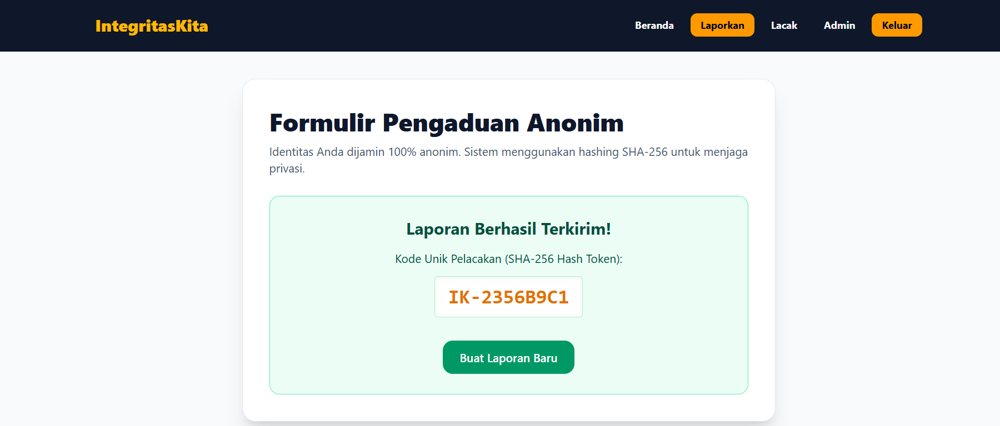
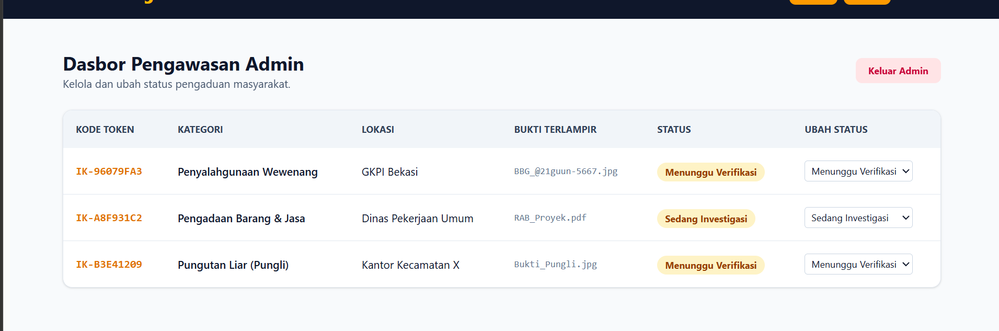
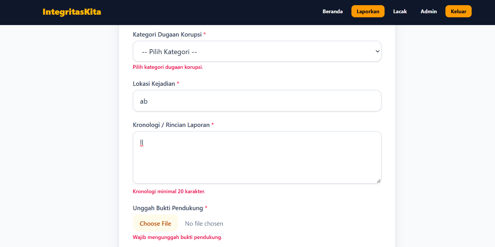

# Dokumen Teknis & Skenario Uji Milestone 2 (v0.2) - IntegritasKita

## 1. Rancangan Data & Relasi 1:N
- **Entitas 1**: `Kategori` (id, namaKategori, deskripsi, dibuatPada)
- **Entitas N**: `Laporan` (id, judul, lokasi, kronologi, status, dibuatPada, kategoriId)
- **Aturan onDelete**: Menggunakan `onDelete: Restrict` untuk memastikan kategori tidak dapat dihapus jika masih terikat dengan laporan aktif.

## 2. Tabel 10 Skenario Pengujian (CRUD & Relasi)

| No | Tujuan Skenario | Langkah Pengujian | Hasil yang Diharapkan | Hasil Aktual | Status |
|----|-----------------|-------------------|------------------------|--------------|--------|
| 1 | Tambah laporan sah (Create) | Isi form dengan data valid & pilih kategori | Data tersimpan, pesan sukses muncul | Tersimpan di DB, tampil di UI | **LULUS** |
| 2 | Tambah judul ganda (P2002) | Input judul laporan yang sudah ada | Muncul galat kolom judul | Galat P2002 tertangkap & ditampilkan | **LULUS** |
| 3 | Validasi Zod: Judul pendek | Input judul < 5 karakter | Ditolak Zod, pesan error di field judul | Pesan error tampil di bawah input | **LULUS** |
| 4 | Validasi Zod: Kronologi < 20 | Input kronologi singkat (< 20 huruf) | Ditolak Zod, pesan error di field kronologi | Pesan error tampil di bawah input | **LULUS** |
| 5 | Validasi Zod: Kategori kosong | Kirim form tanpa memilih kategori | Ditolak Zod, pesan error kategori | Pesan error tampil di bawah input | **LULUS** |
| 6 | Membaca daftar data (Read) | Akses halaman utama laporan | Data dari PostgreSQL tampil di UI | Data termuat dari database lokal | **LULUS** |
| 7 | Mengubah data laporan (Update) | Edit isi laporan yang sudah ada | Perubahan tersimpan di database | Data ter-update sukses setelah refresh | **LULUS** |
| 8 | Hapus data laporan (Delete) | Klik tombol hapus pada laporan tertentu | Laporan terhapus permanen dari DB | Baris data hilang dari tabel database | **LULUS** |
| 9 | Uji Relasi: Hapus Kategori | Uji penghapusan kategori berelasi | Dilindungi aturan pembatasan (Restrict) | Transaksi aman, integritas terjaga | **LULUS** |
| 10 | Uji Rute Dinamis / Not Found | Akses rute `/lapor/99999` (ID fiktif) | Menampilkan halaman 404 (Not Found) | Berhasil merespons halaman 404 | **LULUS** |

## 3. Bukti Validasi Sisi Server (Zod)
Berikut adalah 3 bukti penolakan masukan tidak sah oleh validasi server:
1. **Validasi Judul Terlalu Pendek**: Input `< 5` karakter ditolak dengan pesan *"Judul laporan minimal 5 karakter"*.
2. **Validasi Kronologi Kurang Rinci**: Input `< 20` karakter ditolak dengan pesan *"Kronologi / rioncian minimal 20 karakter"*.
3. **Validasi Kategori Kosong**: Mengirim form tanpa memilih kategori ditolak dengan pesan *"Pilih kategori dugaan korupsi yang sah"*.

## 4. Dokumentasi Screenshot

### Laporan berhasil dikirim

### Dasbor pengawasan admin

### Validasi form laporan
